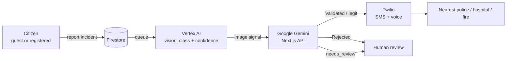

# Citizen report validation flow

Vertex sits **after the queue, before Gemini**. It scores what is in the photo. Gemini combines that with text, GPS/place, and trust to decide the verdict.

| Step | Who | Job |
|---|---|---|
| 1 | Citizen | Photo + GPS + place text |
| 2 | Firestore | Save report, status `queued` |
| 3 | **Vertex AI** | Image only: flood / accident / unrelated / … |
| 4 | **Gemini** | Match claim + location + trust → legit / rejected / needs_review |
| 5a | Twilio | Alerts / calls when validated (officer-triggered) |
| 5b | Officer | Human review when rejected or unsure |

Do **not** call Vertex for location. Location is GPS + place text (and Maps if needed). Vertex is vision only.
