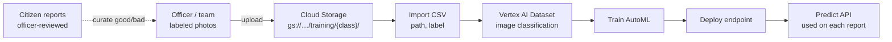

# Vertex AI dataset ingest flow

One-time (or batch retrain) path. Separate from live report predict.

## Steps

1. Collect labeled images (`flood`, `accident`, `fire`, `landslide`, `unrelated`, …)
2. Store in GCS under class folders (or any layout + CSV)
3. Import into a **Vertex image dataset** (Console or API) via CSV:
   `gs://bucket/…/img.jpg,accident`
4. **Train** AutoML image classification
5. **Deploy** model to an endpoint
6. App calls **predict** on submit (see report validation flow)

## When to ingest again

| Trigger | Action |
|---|---|
| First setup | Full dataset → train → deploy |
| Officers labeled +50–100 / class | Append to GCS + CSV → re-import → retrain → new endpoint |
| Monthly schedule (1st, 02:00 Asia/Manila) | BigQuery → GCS `labels.csv` (paths already in bucket) |
| Live citizen submit | **Do not** auto-ingest photos; predict only |

### Scheduled BigQuery → GCS (labels index)

After each verdict, rows land in BigQuery with `gcs_uri` + `label`. A monthly job exports:

`gs://luwas-media-nice-pen-181017/luwas-vision-ingest/latest/labels.csv`  
(also dated: `…/YYYY-MM-DD/labels.csv`)

- Manual: `npm run bq:vertex-ingest`
- HTTP: `POST /api/cron/vertex-ingest-export` with `Authorization: Bearer $CRON_SECRET`
- Cloud Scheduler: monthly hit on that route (prod)

Import that CSV into dataset **luwas-vision-v1** when you are ready to retrain. Photos are not re-copied; only the labeled index is refreshed.

Live path stays: `queue → Vertex predict → Gemini → verdict`.
