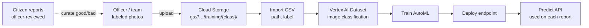

# Vertex AI dataset ingest flow

One-time (or batch retrain) path. Separate from live report predict.

## Steps

1. Collect labeled images (`flood`, `accident`, `fire`, `landslide`, `unrelated`, …)
2. Store in GCS under class folders (or any layout + CSV)
3. Import into a **Vertex image dataset** (Console or API) via CSV:
   `gs://bucket/…/img.jpg,accident`
4. **Train** AutoML image classification
5. **Deploy** model to an endpoint
6. App calls **predict** on submit (see report validation flow)

## When to ingest again

| Trigger | Action |
|---|---|
| First setup | Full dataset → train → deploy |
| Officers labeled +50–100 / class | Append to GCS + CSV → re-import → retrain → new endpoint |
| Live citizen submit | **Do not** auto-ingest; predict only |

Live path stays: `queue → Vertex predict → Gemini → verdict`.
